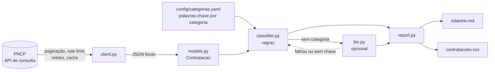

# radar-licitacoes-pncp

*Python CLI that pulls public procurement notices from Brazil's PNCP API, classifies them by keyword rules (optional LLM fallback) and writes Markdown and CSV reports.*

## O problema

Toda compra pública brasileira regida pela Lei 14.133/2021 é publicada no **PNCP** (Portal Nacional de Contratações Públicas), e a API de consulta é aberta e sem autenticação. Os dados existem, mas acompanhá-los na prática é trabalhoso:

- só há filtro por UF, modalidade e data. Não há busca por tema nem agregação ("quantas dispensas de software, em quantos órgãos, a que valor?");
- a API pagina em blocos de 50, devolve `204` quando não há resultado, rejeita tamanhos de página inválidos com `400` e responde `429` quando o ritmo passa de um limite não documentado;
- o texto do objeto é livre, com maiúsculas, acentos, tags como `[Cancelado]` e erros de digitação.

Este projeto automatiza o ciclo: **baixar, normalizar, classificar por categoria e resumir**. As categorias vêm de um arquivo YAML/JSON de palavras-chave, então servem para qualquer tema (TI, saúde, obras), não só o exemplo.

## Arquitetura



| Módulo | Responsabilidade |
|---|---|
| `client.py` | `GET` com intervalo mínimo entre pedidos, backoff exponencial (respeita `Retry-After`), retry só em 408/425/429/5xx e erros de rede, `204` como lista vazia, janela de datas fatiada em blocos, cache em disco por URL, deduplicação por `numeroControlePNCP`. O transporte HTTP é injetável. |
| `models.py` | Converte o JSON da API em `Contratacao` (campos achatados, tag inicial removida, link do edital). |
| `config.py` | Carrega e valida o YAML/JSON de categorias. |
| `classifier.py` | Normaliza o texto (sem acento, sem caixa) e casa termos por categoria. |
| `llm.py` | Classificador opcional para o que as regras não acharam. |
| `report.py` | Tabela agregada (contratações, órgãos, mediana, total, ritmo semanal), seções por categoria e CSV. |
| `cli.py` | Comandos `baixar` e `analisar`. |

### Decisões de design

- **Regras primeiro, LLM depois.** Palavras-chave são determinísticas, auditáveis (o CSV mostra os termos que casaram) e custam zero. O LLM só vê objetos sem categoria e que não caíram em nenhum termo de exclusão, tem teto de chamadas (`--llm-max`), cache em disco, e qualquer falha (sem chave, sem pacote, erro de API, resposta fora das categorias) devolve o registro como as regras o deixaram. O modo offline é o padrão.
- **Sintaxe mínima de termos, sem regex.** `termo` casa no início de palavra (`chatbot` pega `chatbots`), `termo$` exige fim de palavra (`ia$` não pega `iate`) e `^termo` ancora no começo do objeto. Evita que o arquivo de configuração vire um repositório de expressões regulares.
- **Mais termos distintos vence; empate segue a ordem do arquivo.** Um objeto "software de atendimento virtual com chatbot e whatsapp" cai em chatbot, não em software genérico. O trade-off é que a ordem das categorias importa no empate.
- **Exclusão global antes de tudo.** Compras de bens, obras e alimentação são a maior parte das dispensas; descartá-las cedo reduz falsos positivos (e custo de LLM).
- **Janela fatiada e cache.** Uma janela de 90 dias em MG é ~260 páginas. Fatiar em blocos de 30 dias limita o dano de uma falha e o cache (`--cache`) permite reexecutar a análise sem tocar na rede.
- **Valores abaixo de R$ 100** (sigilosos ou `0,01`) ficam fora de mediana e soma (`valor_minimo_confiavel` no YAML).

## Como rodar

Requer Python 3.9+.

```sh
python3 -m venv .venv && source .venv/bin/activate
pip install -e '.[dev]'          # '.[llm]' adiciona o SDK da Anthropic (opcional)

# dispensas de MG nos últimos 90 dias: baixa, classifica e gera saida/relatorio.md + saida/contratacoes.csv
radar-pncp -v analisar --uf MG --modalidades 8 --dias 90 --cache cache --saida saida

# pregões eletrônicos e credenciamentos com proposta ainda aberta
radar-pncp analisar --uf MG --modalidades 6,12 --modo abertas --saida saida-abertas

# janela explícita e outra configuração de categorias
radar-pncp analisar --uf SP --modalidades 8 --inicio 2026-09-01 --fim 2026-09-30 --config minhas-categorias.yaml

# só baixar (JSON bruto) e analisar depois, sem rede
radar-pncp baixar --uf MG --modalidades 8 --dias 30 --saida dispensas.json
radar-pncp analisar --entrada dispensas.json --saida saida
```

Códigos de modalidade aceitos (`--modalidades`): 1 leilão eletrônico, 2 diálogo competitivo, 3 concurso, 4 concorrência eletrônica, 5 concorrência presencial, 6 pregão eletrônico, 7 pregão presencial, 8 dispensa, 9 inexigibilidade, 10 manifestação de interesse, 11 pré-qualificação, 12 credenciamento, 13 leilão presencial.

### Configuração de categorias

```yaml
valor_minimo_confiavel: 100
categorias:
  - id: site
    nome: Site, portal, hospedagem, e-mail
    aderencia: alta            # alta | media | baixa: rótulo seu
    palavras_chave: [sitio eletronico, site, website, portal institucional]
    excluir: [ssl]             # opcional: anula só esta categoria
excluir_global: [^aquisicao, obra, medicament]   # descarta o objeto inteiro
```

A configuração padrão (`config/categorias.yaml`) cobre serviços de TI e comunicação digital. Também aceita JSON.

### Classificador por LLM (opcional)

```sh
export ANTHROPIC_API_KEY=...
pip install -e '.[llm]'
radar-pncp analisar --entrada dispensas.json --llm anthropic --llm-max 100
```

Sem chave ou sem o pacote, o programa avisa e segue só com regras. A integração com a API real da Anthropic **não foi exercitada** neste repositório: os testes cobrem o fluxo com um cliente falso (prompt, parsing, limite de chamadas, cache, fallback em erro).

## Exemplo de saída real

Execução de 16/10/2026 (`radar-pncp analisar --uf MG --modalidades 8 --dias 90`, janela 18/07 a 16/10/2026): **13.051 dispensas** baixadas da API em ~25 minutos (~260 páginas, dezenas de respostas `429` absorvidas pelo backoff), das quais 444 caíram em alguma categoria, 6.862 foram descartadas pelos termos de exclusão e 5.745 ficaram sem categoria.

| Categoria | Aderência | Contratações | Órgãos | Valor mediano | Valor total | Ritmo |
|---|---|---:|---:|---:|---:|---:|
| Chatbot, WhatsApp, IA | alta | 33 | 21 | R$ 5.843 | R$ 1.816.067 | ~2,6/semana |
| Site, portal, hospedagem, e-mail | alta | 46 | 41 | R$ 14.720 | R$ 1.100.581 | ~3,6/semana |
| Redes sociais, marketing digital, comunicação | alta | 39 | 37 | R$ 37.431 | R$ 1.780.833 | ~3/semana |
| Desenvolvimento de sistema/aplicativo sob medida | media | 2 | 2 | R$ 32.579 | R$ 65.158 | ~0,2/semana |
| Treinamento, oficina de informática, suporte de TI | media | 9 | 6 | R$ 13.704 | R$ 161.124 | ~0,7/semana |
| Software/plataforma por licença | baixa | 213 | 175 | R$ 26.400 | R$ 47.487.352 | ~16,6/semana |
| Vídeo, foto, audiovisual | baixa | 102 | 76 | R$ 7.704 | R$ 1.910.160 | ~7,9/semana |

Esses números dependem das palavras-chave do YAML padrão; são contagens por correspondência de termos, não uma taxonomia validada. O relatório completo (com as 10 maiores contratações de cada categoria e links para o PNCP) está em [`exemplos/relatorio-mg-90d.md`](exemplos/relatorio-mg-90d.md). O CSV traz uma linha por contratação:

```
id,categoria,aderencia,metodo,termos,uf,municipio,orgao,modalidade,valor_estimado,data_publicacao,data_encerramento,objeto,link
```

## Testes

```sh
pytest
```

41 testes passando (`41 passed`), sem rede: o cliente recebe um transporte falso e as respostas gravadas em `tests/fixtures/` (23 registros reais de dispensas de MG, dados públicos, em duas páginas). Cobrem paginação, `204`, retry com backoff e `Retry-After`, erro de cliente sem retry, esgotamento de retries, rate limit, cache, deduplicação, sintaxe dos termos, exclusões, validação da configuração, o fallback do LLM e a geração de Markdown/CSV pela CLI.

## Limitações

- **A classificação é lexical.** Há falsos positivos ("software" casa muita coisa fora do alvo) e falsos negativos: 5.745 das 13.051 dispensas do exemplo não casaram com nenhum termo nem com a exclusão, e esse resíduo não foi auditado. Não há medição de precisão/recall.
- **Valor estimado, não contratado.** Usa `valorTotalEstimado`; dispensas sigilosas aparecem sem valor. Somas de categorias com itens grandes (a categoria de software tem totais dominados por poucos contratos) são sensíveis a outliers, por isso a mediana é mostrada junto.
- **Só a fase de publicação da contratação.** Não acompanha homologação, contratos nem atas; não baixa itens nem anexos do edital.
- **Rate limit não documentado.** O PNCP devolve `429` mesmo a ~1,4 pedido/s; o cliente se recupera por backoff, mas uma janela grande leva dezenas de minutos. Ajuste `--intervalo` se necessário.
- **`publicadas` e `abertas` são visões diferentes.** O primeiro olha a data de publicação; para saber o que ainda aceita proposta use `--modo abertas`.
- **O LLM não foi validado contra a API real** (ver acima) e só complementa as regras; não há avaliação de qualidade.
- A configuração padrão é um exemplo de TI/comunicação; outros temas exigem um YAML próprio.

## Próximos passos

- Conjunto de avaliação rotulado à mão para medir precisão/recall por categoria e comparar regras vs. LLM.
- Execução agendada com diff (avisar só o que é novo desde a última rodada).
- Enriquecer com itens e anexos do edital (endpoint de itens do PNCP).

## Licença

MIT. Autor: Jhuan Montoya.
